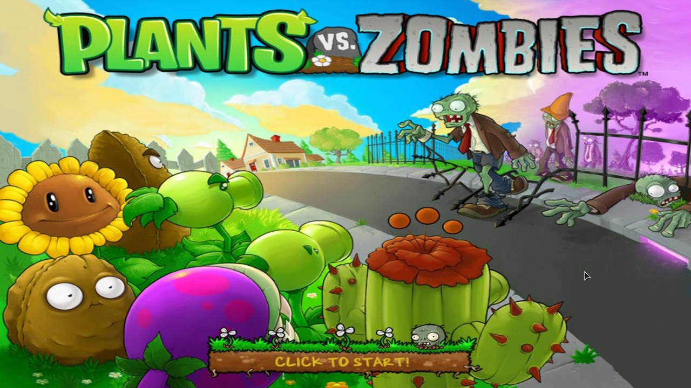
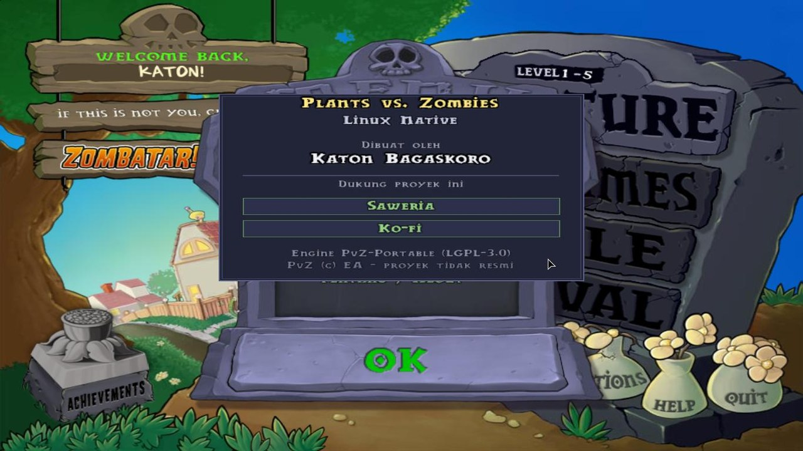

<!--
  ┌───────────────────────────────────────────────────────────────────────┐
  │  pvz-native-linux — Copyright (C) 2026 Katon Bagaskoro                │
  │  Licensed under GNU GPL-3.0-or-later. See LICENSE.                    │
  │  Do NOT remove this notice. Do not re-upload under a different name.  │
  └───────────────────────────────────────────────────────────────────────┘
-->

[](https://github.com/Katon17/pvz-native-linux/actions/workflows/build.yml)
[](https://github.com/Katon17/pvz-native-linux/actions/workflows/attribution.yml)
[](LICENSE)
[](docs/SPECIFICATIONS.md)

# Plants vs. Zombies — Native Linux (`.deb`)

🇮🇩 **Bahasa Indonesia**: lihat [README.id.md](README.id.md)

[](https://github.com/Katon17/pvz-native-linux/releases)
[](#install)
[](https://github.com/wszqkzqk/PvZ-Portable)
[](#legal)

A Linux launcher and asset manager for a **native, emulator-free build of
Plants vs. Zombies: Game of the Year**, built on the open source
[PvZ-Portable](https://github.com/wszqkzqk/PvZ-Portable) engine.

Point it at your own legally owned game (ISO, Steam folder, or ZIP) and it
extracts the assets, sets up a desktop entry with a proper icon, and runs the
game as a **normal native Linux program** — no Wine, no emulator, no Proton.

```
┌──────────────────────────────────────────────────────────┐
│  Your ISO  ─►  built-in ISO9660 reader  ─►  ~/.local/…  │
│  or folder                                    │          │
│                                               ▼          │
│                          PvZ-Portable engine (native)    │
│                          SDL3 + OpenGL ES 2.0            │
└──────────────────────────────────────────────────────────┘
```

---

## Screenshots

Both screenshots are from the same ThinkPad X270 running Linux Mint 22.3 XFCE,
captured at 1366×768 with **Fill Screen (16:9)** enabled — no black bars, no
Wine, no emulator.

| Main menu | About panel, inside the game |
|---|---|
| [](docs/screenshots/menu.jpg) | [](docs/screenshots/about.jpg) |

The second one shows the in-game **About** dialog reachable from *Options*: the
author credit and the Saweria / Ko-fi donation buttons are real, clickable
buttons inside the engine — not a separate GTK window.

> **These screenshots contain Plants vs. Zombies artwork, © Electronic Arts
> Inc.** They are included here as factual screenshots of the software running
> for documentation and review purposes only. They are **not** part of the
> package, are **not** licensed under the GPL, and are **not** an offer to
> distribute game assets. See [NOTICE](NOTICE). Only real gameplay captures are
> accepted — do not send artwork, `main.pak` contents, or asset files.

---

## Documentation

Every document is available in **English** and **Indonesian**. Files without an
`.id` suffix are the English version (the default on GitHub).

| Document | Contents |
|---|---|
| [docs/SPECIFICATIONS.md](docs/SPECIFICATIONS.md) · [🇮🇩](docs/SPECIFICATIONS.id.md) | **Minimum & recommended specs** — CPU, RAM, GPU, disk, drivers |
| [docs/BUILDING.md](docs/BUILDING.md) · [🇮🇩](docs/BUILDING.id.md) | Building the engine & package from scratch |
| [docs/ARCHITECTURE.md](docs/ARCHITECTURE.md) · [🇮🇩](docs/ARCHITECTURE.id.md) | Data flow, engine patch, design decisions |
| [docs/PROTECTION.md](docs/PROTECTION.md) · [🇮🇩](docs/PROTECTION.id.md) | **License, copyright, and rules for using this work** |
| [SECURITY.md](SECURITY.md) · [🇮🇩](SECURITY.id.md) | Reporting vulnerabilities |
| [CONTRIBUTING.md](CONTRIBUTING.md) | Contribution rules & commit style |
| [CHANGELOG.md](CHANGELOG.md) | Change history |
| [NOTICE](NOTICE) | Full legal statement |

## Why this exists

The upstream engine gives you a binary and tells you to "put `main.pak` and
`properties/` next to it". That is fine if you are a developer. It is not fine
if you are a user on Linux Mint who just wants to play.

This project handles the boring, error-prone parts:

| Problem you would hit | What this launcher does |
|---|---|
| "Where do I put `main.pak`?" | First-run wizard extracts it for you |
| ISO mounting needs `fuse`, `7z`, or root | **Pure-Python ISO9660 reader** — no external tools, no root, no mount |
| Official CD is an *installer*, not loose files | Reads the CAB **inside** the installer and extracts `main.pak` for you — no Wine, no Windows |

### ISO is pure Python. CAB mostly is — one case is not.

"Pure-Python, no external tools" applies to ISO reading, and that is the point
of the row above: **you never need to mount anything**. Full breakdown:

| Your source | How it is read | External tool |
|---|---|---|
| **ISO** (`.iso`) | Pure-Python ISO9660 reader, reads the image as an ordinary file | **none** |
| **ZIP** | Pure-Python `zipfile` | **none** |
| **Folder** (Steam / EA App / existing install) | Plain filesystem access | **none** |
| **Installer** (`.exe`) → CAB, **MSZIP or uncompressed** | Pure-Python MSCF decoder (`tools/pvznative/cab.py`) | **none** |
| **Installer** (`.exe`) → CAB, **LZX or Quantum** | `cabextract` subprocess | **`cabextract`** |

The last row is the one that matters in practice, because **PopCap's own
PvZ GOTY 1.2.0.1073 installer uses LZX compression**. Python's standard library
cannot decode LZX, and writing an LZX decoder by hand is not worth the risk, so
the launcher tries the built-in decoder first and falls back to `cabextract`
only when it hits a compression it cannot handle.

`cabextract` is declared as a package dependency, so
`sudo apt install ./pvz-native_*.deb` installs it automatically. If you use an
ISO, a Steam folder, or a ZIP, it is never invoked at all.
| Steam GOTY (1.2.0.1096) has cosmetic bugs | Detects the asset version *before* you play and warns you |
| Game silently does nothing on launch | Engine exits with code 0 on fatal errors — launcher inspects the log and shows a real dialog |
| Game data mixed into `/usr` | Assets live in your home directory, survive package upgrades |
| No menu entry, generic icon | Native `.desktop` entry with a proper icon set |

---

## Install

### Quick install (Debian / Ubuntu / Linux Mint / Pop!_OS)

Download `pvz-native_0.5.2_amd64.deb` from
[Releases](https://github.com/Katon17/pvz-native-linux/releases), then:

```bash
sudo apt install ./pvz-native_0.5.2_amd64.deb
```

Verify the download first (recommended):

```bash
sha256sum -c pvz-native_0.5.2_amd64.deb.sha256
```

### First run

Open your menu → **Games → Plants vs. Zombies**. The wizard asks where your
game files are:

1. **ISO / ZIP / installer (.exe)** — point at your disc image, archive, or
   the official `PlantsVsZombiesSetup.exe`. Installer discs are supported: the
   wizard pulls `main.pak` out of the embedded CAB.
2. **Folder** — point at `PlantsVsZombies` from Steam, EA App, or an existing
   install.

Steam libraries are detected automatically. Assets are copied to
`~/.local/share/pvz-native/assets/` and the game starts.

Subsequent launches skip the wizard and go straight into the game.

### Manual / other distros

The `.deb` is just a tar archive with extra metadata. On Arch or Fedora:

```bash
tar -xf pvz-native-0.5.2-x86_64.tar.gz -C ~/.local   # launcher + python package
pvz-native --setup                            # then point at your assets
```

or build from source (see below). Keep in mind that the upstream engine binary
is built against glibc; it will not run on musl-only systems without a build.

---

## Requirements

Ringkas — rincian lengkap (termasuk cara memverifikasi driver) ada di
[docs/SPECIFICATIONS.md](docs/SPECIFICATIONS.md).

| | Minimum | Recommended |
|---|---|---|
| **CPU** | x86_64 with SSE2 (any CPU since 2003) | 2 cores, 1.6 GHz |
| **RAM** | **1 GB** | 2 GB |
| **GPU** | OpenGL ES 2.0 **or** OpenGL 2.1 | Intel HD 4000+ / any AMD GCN |
| **Driver** | `libgl1-mesa-dri` installed | `iris`, `i965`, or `radeonsi` active |
| **Disk** | **350 MB** free | 1 GB |
| **Screen** | 1024×768 | 1366×768 or larger |
| **OS** | glibc ≥ 2.34, x86_64 | Linux Mint 22.x / Ubuntu 24.04 |
| **Session** | X11 or Wayland (via XWayland) | — |
| **Extra** | `cabextract` (only for `.exe` installers) | — |

> PvZ is an old game. If your machine can run a compositor smoothy, it can run
> this. Do not expect to be told "100+ FPS" here — the original game logic is
> frame-locked at 30/60 FPS by design.

---

## Controls

| Action | Keyboard |
|---|---|
| Move cursor / collect sun | Mouse |
| Plant seed packet | Left click |
| Shovel | Click shovel, then the plant |
| Pause | `Esc` |
| Fullscreen | `Alt`+`Enter` (engine default) |
| Quit | Close the window or `Esc` → menu |

Gamepads are supported by the engine through SDL3 but the official build is
mouse-first; keyboard/gamepad bindings are on the upstream roadmap.

---

## Where files live

| What | Where |
|---|---|
| Extracted assets | `~/.local/share/pvz-native/assets/` |
| Save games / profile | `~/.local/share/pvz-native/saves/` |
| Logs from failed runs | `~/.local/share/pvz-native/logs/` |
| Launcher state | `~/.config/pvz-native/state.json` |
| Engine binary | `/usr/lib/pvz-native/engine/pvz-portable` |

Nothing is written to `/usr` after installation, and uninstalling the package
**never** deletes your save data.

---

## CLI reference

```bash
pvz-native                      # play (runs setup first if needed)
pvz-native --setup              # re-run the asset wizard
pvz-native --setup --iso ~/pvz.iso --yes    # non-interactive
pvz-native --where              # show all paths
pvz-native --doctor             # diagnose engine, assets, GL drivers
pvz-native --verify             # re-validate installed assets
pvz-native --debug              # run with engine logs in the terminal
pvz-native display fullscreen   # screen mode (or windowed / show)
pvz-native --settings          # settings window (no terminal needed)
pvz-native --about             # About dialog: author, credits, support links
pvz-native uninstall            # remove assets, keep saves
pvz-native --inspect ~/pvz.iso  # check a source without installing
pvz-native uninstall --purge-saves
```

## About & support

**In game:** open **Options** and click the small **"Tentang / About"** link
beneath the *Fill Screen (16:9)* row. A panel opens with the author name
(**Katon Bagaskoro**) and the support links. Click anywhere to close it.

**Outside the game:** the **About** button in the settings window, the
application menu entry (**Plants vs. Zombies — Tentang**), or `pvz-native --about`.

- Saweria — <https://saweria.co/Kabako>
- Ko-fi — <https://ko-fi.com/katonbagaskoro>

Useful environment variables:

| Variable | Effect |
|---|---|
| `PVZ_ENGINE` | Use a different engine binary |
| `PVZ_NATIVE_ASSETS` | Override the assets directory |
| `PVZ_NATIVE_DEBUG=1` | Keep the engine log on stdout |
| `PVZ_NATIVE_NO_GUI=1` | Force text mode (zenity/kdialog bypass) |

---

## Troubleshooting

### Fullscreen but with black bars

In game: **Options** → tick **Fill Screen (16:9)** (on by default).
Or from a terminal: `pvz-native --wide` / `--no-wide` — the choice is saved.
4:3 is PvZ’s native layout, so stretching shifts some UI elements slightly;
gameplay is unaffected.

### "Driver OpenGL tidak bisa membuat konteks" / black screen

```bash
sudo apt install libgl1-mesa-dri mesa-utils
unset MESA_GL_VERSION_OVERRIDE LIBGL_ALWAYS_SOFTWARE
LIBGL_ALWAYS_SOFTWARE=1 pvz-native --debug    # software rendering test
```

If software rendering works but hardware does not, you have a driver problem,
not a game problem. Check `glxinfo -B`.

### "missing resource compiled/reanim/…" / game closes immediately

The wizard now **rejects** such a source outright, so you can never reach
an "installed" state with unusable assets.

Your `main.pak` is from a different build. A valid PC `main.pak` from
1.2.0.1073 is ~42.8 MiB with 3195 entries and contains
`reanim/LoadBar_sprout.reanim`. A 24 MB file dated 2009 is a reduced/older
build and will not boot this engine.

```bash
pvz-native --verify                 # checks required entries + size
pvz-native --setup --force          # point at a complete PC release
```

If the engine produces no message at all, run it with the log visible:

Run it with the log visible:

```bash
pvz-native --debug
```

The engine exits with code 0 even on fatal errors, and a hard crash returns
128+signal — so the launcher now names the signal (SIGSEGV, SIGABRT, …) and
saves the log to `~/.local/share/pvz-native/logs/last-crash.log`.

The most common cause on Intel HD / older Mesa is a missing or broken GL
driver:

```bash
pvz-native --doctor        # prints GPU, OpenGL renderer, Vulkan ICDs, DRI drivers
LIBGL_ALWAYS_SOFTWARE=1 pvz-native --debug
```

### "FATAL ERROR — Failed to load image: properties/partner_logo"

Your asset set is incomplete: `resources.xml` (inside `main.pak`) declares
`partner_logo`, but the image ships as a **loose file** in the installer.
Fixed in 0.2.1. Re-run setup with force:

```bash
pvz-native --setup --force
pvz-native --verify      # should print "aset gambar: 691/691 tersedia"
```

### The wizard says it could not find `main.pak` in the installer

The CD installer is supported — it is read through `cabextract` (declared as a
package dependency). If you are running from source, install it:

```bash
sudo apt install cabextract
```

Still failing? Some installers split their data across several files, or ship
with custom DRM. In that case install the game once on Windows or in a Wine
prefix and point the wizard at the resulting `PlantsVsZombies` folder.

### Which assets should I use?

`main.pak` from the CD installer is **XOR-obfuscated** (`0x4D37BD37` on disk
instead of `0xBAC04AC0`). That is normal and supported: the engine un-XORs it
at load time. Use as-is, do not "fix" the file.

The CD installer does not include `properties/default.xml`, but that file is
**optional** for this engine (`properties/*` are override layers).

Assets are collected from two places and merged into one `properties/` folder:

| Source | Contents |
|---|---|
| Inside `main.pak` | `resources.xml`, `LawnStrings.txt`, `ZombatarTOS.txt` |
| Loose files in the installer | `partner.xml`, `partner_logo.jpg`, `*.sig` |

Both are required. `--verify` audits every `<Image path="…">` declaration in
`resources.xml` against what is actually on disk.

### Almanac text is missing, "Restart" label absent, zombies show `???`

You are running **Steam GOTY 1.2.0.1096** assets. Gameplay is complete; these
are known cosmetic differences documented by upstream. Use the standalone
PopCap **1.2.0.1073** release for a clean experience.

### Sun/coins counter shows wrong Crazy Dave prices

Same root cause as above: `LawnStrings.txt` format changed in 1.2.0.1096.

### Game launched but nothing appears (Wayland)

Try `SDL_VIDEODRIVER=x11 pvz-native`. If the game appears windowed but never
fullscreen, your compositor is likely blocking fullscreen on first map — press
`Alt`+`Enter`.

### Save file location after switching from another port

Save data format is largely compatible with other PvZ-Portable builds. Copy
your old save into `~/.local/share/pvz-native/saves/` before launching.

---

## Building from source

```bash
git clone https://github.com/Katon17/pvz-native-linux
cd pvz-native-linux
./build-deb.sh --fetch-engine     # downloads + verifies upstream engine
```

Output: `release/pvz-native_0.5.2_amd64.deb` plus a `.sha256` file.

To hack on the launcher without rebuilding:

```bash
cd pvz-native-linux
export PYTHONPATH="$PWD/tools"
export PVZ_ENGINE="$PWD/lib/pvz-native/engine/pvz-portable"
python3 -m pvznative doctor
./scripts/pvz-native --setup --iso ~/your.iso
```

Run the tests (no game assets required — synthetic ISOs are generated):

```bash
python3 -m unittest discover -s tests -t tests -v
```

---

## Legal

**This package contains no game assets.** Not one byte of PopCap/EA artwork,
audio, or data ships in the `.deb`.

- You must supply `main.pak` and `properties/` from a copy **you own**
  (Steam app 3590, EA App, or the original CD).
- The asset wizard only copies files from your own storage into your own home
  directory. Nothing is uploaded anywhere.
- The bundled engine (`PvZ-Portable`) is an independent open source
  reimplementation by Zhou Qiankang, licensed **LGPL-3.0-or-later**.
- "Plants vs. Zombies" is a trademark of Electronic Arts Inc. This is an
  unofficial, non-commercial compatibility project, not affiliated with or
  endorsed by EA or PopCap.

See [NOTICE](NOTICE) for the full statement.

## Credits

- **Launcher & packaging**: [Katon Bagaskoro (@Katon17)](https://github.com/Katon17)
- **Engine**: [PvZ-Portable](https://github.com/wszqkzqk/PvZ-Portable) by
  Zhou Qiankang — the actual hard work
- **Original framework**: PopCap SexyAppFramework (released under a permissive
  license), reimplemented by the PvZ-Portable community
- **Libraries**: SDL3, SDL3_mixer, libopenmpt, libpng, libjpeg-turbo

## License

| Komponen | Lisensi |
|---|---|
| Launcher, wizard, packaging, test (`scripts/`, `tools/`, `tests/`, `build-deb.sh`) | **GPL-3.0-or-later** |
| Engine PvZ-Portable (biner pihak ketiga) | **LGPL-3.0-or-later** |
| Aset game | **© Electronic Arts** — tidak pernah didistribusikan di sini |

Copyright (C) 2026 **Katon Bagaskoro**. Teks lengkap: [LICENSE](LICENSE),
penjelasan hak & kewajiban: [docs/PROTECTION.md](docs/PROTECTION.md),
pernyataan legal: [NOTICE](NOTICE).

**Ringkas soal apa yang boleh:** kode ini bebas dipakai dan dimodifikasi, tapi
siapa pun yang mendistribusikan versi modifikasi **wajib membuka sumbernya**
dengan lisensi sama dan **wajib mempertahankan kredit penulis**. Dilarang
memakai nama/ikon proyek ini untuk membuat orang mengira versinya resmi.
